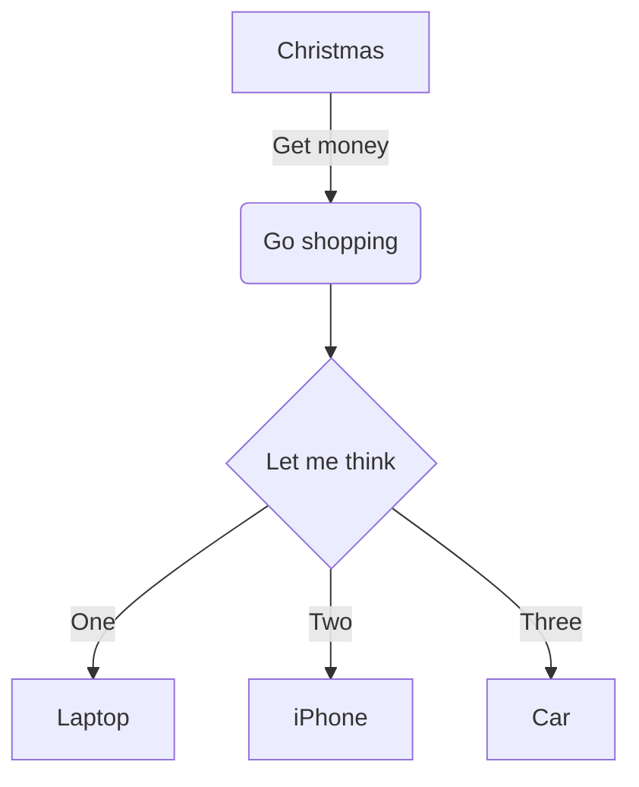

# Mermaid



# Header

## 1. Header

## (1) Header

## 【1】 Header

## 2. 日本語見出し

## 「2」 日本語見出し

## 【2】 日本語見出し

```csharp
Public void Sub1(string arg)
    Console.WriteLine(arg);
End Sub
```

# KaTeX
## inline
$\sqrt{3x-1}+(1+x)^2$

## block
$$\begin{array}{cc}

\nabla \times \vec{\mathbf{B}} -\, \frac1c\, \frac{\partial\vec{\mathbf{E}}}{\partial t} &
= \frac{4\pi}{c}\vec{\mathbf{j}} \\
\nabla \cdot \vec{\mathbf{E}} & = 4 \pi \rho \\

\nabla \times \vec{\mathbf{E}}\, +\, \frac1c\, \frac{\partial\vec{\mathbf{B}}}{\partial t} & = \vec{\mathbf{0}} \\

\nabla \cdot \vec{\mathbf{B}} & = 0

\end{array}$$